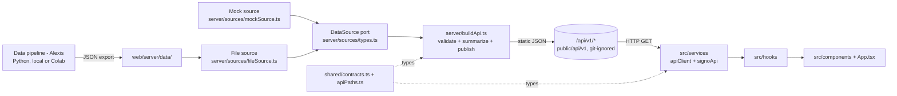

# 2. Architecture

## Where things live

| Place | Holds | Why |
|---|---|---|
| This repo, `C:\Users\DiNiCHi\dev\SIGNO`, remote `github.com/AetherKernel/SIGNO` | Code, notebooks, these docs | Outside Google Drive (ADR-001) |
| Drive `03 Proyectos IA/SIGNO` | Team documents: research, notes, drafts, design system core | Team only, not code |
| Drive `03 Proyectos IA/SIGNO/submission` | Submission material in English: demo video, slides, AI-generated images (watermarked), sources of the local data point | Public link, this folder only (same pattern as the 2025 winners) |
| `data/` in this repo (git-ignored) | Downloaded NASA data | Too large to version; cited in README |

## Layers (ADR-004)

Everything deployable lives in `web/` (Vercel's Root Directory, ADR-003), split into three layers that only talk
through the shared contract. `npm run check:layers` (part of `npm run build`) fails the build if a layer imports
what it must not.

| Layer | Folder | Responsibility | May import |
|---|---|---|---|
| Contract | `web/shared/` | Data contract types (`contracts.ts`) and the API route map (`apiPaths.ts`). No logic | Nothing |
| Backend | `web/server/` | Data source port and adapters (`sources/`), contract validation (`validate.ts`), business rules such as the summary counts (`summary.ts`), API publisher (`buildApi.ts`) | `shared/`, Node built-ins |
| Frontend | `web/src/` | `services/` (the only HTTP code), `hooks/` (data and URL state), `components/` + `App.tsx` (views only: no `fetch`, no API client), `lib/` (formatting and colours) | `shared/` |

**Data source switch.** `SIGNO_DATA_SOURCE=mock` (default) or `files` (reads `SIGNO_DATA_DIR`, default
`web/server/data/`). It is the only change needed when Alexis's export arrives; the export format is in
`web/server/data/README.md`. Mock data is flagged `dataStatus: "mock"` end to end, and the UI shows a "Sample data"
banner.

**Frontend routes.** One route, `/`. View state lives in the query string: `?variable=<variableId>&cell=<cellId>`,
so any view can be shared as a link.

## Components

| Component | Folder | State |
|---|---|---|
| Web app (React 19 + Vite 8 + TypeScript, ADR-003) | `web/src/` | Variable picker, trend grid map with a "only significant" toggle, summary counts, monthly series of a selected cell. Runs on mock data |
| API publisher (ADR-004) | `web/server/` | Publishes API v1 (06) from the mock or the pipeline export, after validating it |
| Data processing and analysis | not created yet | Alexis's exploration; method and variables pending (05, P-002) |

Commands, run inside `web/`: `npm install`, `npm run dev` (publishes the API, then starts Vite), `npm run build`
(API, layer check, type check, Vite build), `npm run lint`, `npm run api:build`, `npm run check:layers`.

### Options that were evaluated

Option 1 below was adopted in ADR-004 (static API built from precomputed results). Options 2 and 3 remain possible
additions: `VITE_API_BASE_URL` can point the same frontend at a runtime API later.

| Option | Shape | Status |
|---|---|---|
| 1. Precomputed + static site | Pipeline exports results; the site publishes them as static JSON. Proven by 2025 winner Zumorroda-X | **Adopted (ADR-004)** |
| 2. Option 1 + small serverless function | One light on-demand query on Vercel | Not now: time/size limits, credentials online |
| 3. Option 1 or 2 + LLM explainer | An LLM explains variables (allowed by the challenge text) | Not now; would never decide significance and must be declared |

Whatever the option, the statistical test is the product's core and must be transparent and validated (05, P-007).

## Environments

| Environment | Where | Notes |
|---|---|---|
| Local | Windows 11, Node 22.21, Python 3.13 via `py` | `npm run dev` on port 5173 (Vite default) |
| Preview | Vercel, one URL per pull request | Team review before merging |
| Production | Vercel, deployed from `main`: <https://signo-chi-pink.vercel.app/> | Public link for the submission (ADR-002); verified without login on 2026-11-14. Build settings in `web/vercel.json`; Node `22.x` from `package.json` engines (needed to run the TypeScript backend directly) |

Vercel does not run long processes or Streamlit, so heavy data work stays outside it (ADR-002). Access to NASA data
requires an Earthdata Login account per member; credentials never go in the repo.

## Tests and checks

| Check | Command | What it proves |
|---|---|---|
| Contract validation | `npm run api:build` | Every published file matches the contract; bad pipeline data stops the build with the file, cell and problem |
| Layer boundaries | `npm run check:layers` | `shared/` imports nothing, `server/` never imports `src/`, `src/` never imports `server/` or Node, views never call `fetch` |
| Types | `tsc -b` (in `npm run build`) | `tsconfig.app.json` (src + shared), `tsconfig.server.json` (server + shared + scripts), `tsconfig.node.json` |
| Unit tests | `npm test` (in `npm run build`) | 26 tests with `node:test`: `server/validate.test.ts` (contract rules) and `server/summary.test.ts` (summary counts, mock source satisfies the contract and is deterministic, source selection) |
| Lint | `npm run lint` | oxlint with React and TypeScript plugins |

A failing test, layer check or contract validation stops the Vercel build, so production keeps the last good
version.
