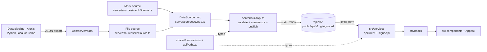

# 2. Architecture

## Where things live

| Place | Holds | Why |
|---|---|---|
| This repo, `C:\Users\DiNiCHi\dev\SIGNO`, remote `github.com/AetherKernel/SIGNO` | Code, notebooks, these docs | Outside Google Drive (ADR-001) |
| Drive `03 Proyectos IA/SIGNO` | Team documents: research, notes, drafts, design system core | Team only, not code |
| Drive `03 Proyectos IA/SIGNO/submission` | Submission material in English: demo video, slides, AI-generated images (watermarked), sources of the opening data point about the Amazon | Public link, this folder only (same pattern as the 2025 winners) |
| `data/` in this repo (git-ignored except `data/README.md`) | Downloaded data | Too large to version, and some licenses forbid redistribution; `data/README.md` says where to get each file |

## Layers (ADR-004)

Everything deployable lives in `web/` (Vercel's Root Directory, ADR-003), split into three layers that only talk
through the shared contract. `npm run check:layers` (part of `npm run build`) fails the build if a layer imports
what it must not.

| Layer | Folder | Responsibility | May import |
|---|---|---|---|
| Contract | `web/shared/` | Data contract types (`contracts.ts`) and the API route map (`apiPaths.ts`). No logic | Nothing |
| Backend | `web/server/` | Data source port and adapters (`sources/`), contract validation (`validate.ts`), business rules such as the summary counts (`summary.ts`), the six-month periods (`periods.ts`) and the calendar years (`annual.ts`), API publisher (`buildApi.ts`) | `shared/`, Node built-ins |
| Frontend | `web/src/` | `services/` (the only HTTP code), `hooks/` (data and URL state), `components/` + `App.tsx` (views only: no `fetch`, no API client), `lib/` (formatting, colour classes, URL view state, base map config, zone trend presentation) | `shared/`, `leaflet` |

**Data source switch.** `SIGNO_DATA_SOURCE=mock` (default) or `files` (reads `SIGNO_DATA_DIR`, default
`web/server/data/`; the maps come from `SIGNO_MAPS_DIR`, default `web/public/data/maps/`). The pipeline export is in
place: `npm run dev:real` and `npm run build:real` use it. The export format is in `web/server/data/README.md`. Mock data is flagged `dataStatus: "mock"` end to end, and the UI shows a "Sample data"
banner.

**Frontend routes.** One route, `/`. The view and all the view state live in the query string, so any view can be
shared as a link:

- `view`: `map` (default) · `trends` · `checks` · `method`. Old links without `view` open the map.
- On the map: `map` (`cover` · `loss` · `burned` · `trend`; tree cover is the default), `var` (trend variable), `year`,
  `show` (`all` · `significant` · `decreasing` · `increasing`), `op` (square opacity, 20–100), `borders` (`0` hides the
  country borders), `base` (`truecolor` · `ndvi` · `none`; Blue Marble when absent), `cell` (the square whose area viewer
  is open), and `z`, `lat`, `lon` once the user moves the map.
- In the area viewer: `from` and `to` (the two years compared).
- On Trends: `zone` (`amazon` · `amazon_brazil` · `amazon_peru`) and `var` (the measure).
- Legacy links still work: `variable` is read as `var`, `filter` as `show`; `src` and `compare` are dropped (see `MapScreen.tsx`).

## Components

| Component | Folder | State |
|---|---|---|
| Web app (React 19 + Vite 8 + TypeScript, ADR-003) | `web/src/` | Four views (see *Interface* below): the map with its filters and the area viewer, Trends, Cross-checks, and Method & sources. Runs on sample data by default; `dev:real` and `build:real` use the pipeline export |
| API publisher (ADR-004) | `web/server/` | Publishes API v1 (06) from the mock or the pipeline export, after validating it. Since 2026-11-15 it also regroups each cell's yearly values and trend rows into `cells/{cellId}.json` (`cellBundle.ts`), the one file the area viewer loads |
| Data pipeline | `pipeline/` | Complete for every source (15 Nov 2026): four monthly products (1,270 monthly files, 2026-11-14), MOD44B, MCD64A1, Hansen and GRACE (`tiles.py`, `hansen.py`, `grace.py`). Outputs: `export_json.py` (zone values → `web/public/data/*.json`), `export_maps.py` (0.05° PNG layers → `web/public/data/maps/`), `export_api.py` (1° API source → `web/server/data/`), `export_cover.py` (`cover.json`), `validate.py` (cross-checks → `validation.json` in both folders), `trends.py` (step 8: the team's trend test, ADR-006; fills the trend results, `zones.json` and `trendChecks`; must run last) and `export_borders.py` (step 9: `web/public/data/borders.json`, independent of the others). Monthly steps: `download.py` (earthaccess, one month at a time, up to 3 tries; reruns skip months already in `data/interim/`) → `clip_clean.py` (clip to the Amazon box, scale, units, checks; writes `data/interim/<PRODUCT>/<YYYY-MM>.nc`). Settings and team decisions in `pipeline/config.py`. Run from the repo root with `.venv` (`pipeline/requirements.txt`). Boundary zips go in `data/raw/boundaries/`. Details: `pipeline/README.md` |
| Notebooks | `notebooks/` | `signo_pipeline_colab.ipynb` (16 sections, one cell per pipeline step, including `export_cover`) and the conventions in `notebooks/README.md`. Not yet run end to end in Colab, and it does not yet run `trends` or `export_borders`. Colab as the processing environment is not decided, so it is not recorded as an ADR (if adopted, ADR-007; 05, P-018) |
| Trend analysis | `pipeline/trends.py`, `pipeline/test_trends.py` | Mann-Kendall test on yearly values, Sen's slope, Benjamini-Hochberg FDR, validation V1–V4 (ADR-006). Reads `web/server/data/` and `web/public/data/` |

**Data flow:** NASA Earthdata and Hansen/UMD (global files and tiles) → `data/raw/` (each file deleted after its step) → `data/interim/` (Amazon
clip and 0.05° cell statistics, about 1.4–2.6 MB per MODIS month; failed months retried up to 3 times; logs per product in `data/interim/logs/`) → `web/server/data/` (API source: `export_api.py`, `export_cover.py`, `validate.py`, `trends.py`) and `web/public/data/` (JSON, PNG maps, `validation.json`, `borders.json`). Both are versioned (commit `4683512`) → Vercel builds them with `npm run build:real`. Only these outputs are published;
raw data, clips, masks, logs and boundary files (`data/raw/boundaries/`) stay out of git.

### Interface (views of 15 Nov 2026)

**Language (ADR-007).** English by default; Spanish when the user picks **ES** in the top bar (`?lang=es`, kept in shared
links). `web/src/lib/i18n.ts` holds a React context and `t('English', 'Español')`; every view sentence is written in
both languages where it is used, and lib functions that build sentences take `t` (English by default). Numbers keep
the decimal point. Text that comes from the API (variable names, method descriptions, notes) stays in English until
the pipeline publishes it in Spanish (05). Icons: Tabler Icons (`@tabler/icons-react`, MIT), so far only in the
language switch.

**Views loaded on demand.** Trends, Cross-checks and Method & sources load their own files the first time they open
(`web/src/lib/lazyView.ts`). File names change with each deploy, so a tab opened before a deploy asks for files that no
longer exist. In that case the page reloads once to get the new files. If loading fails again within a minute,
`components/ViewLoadError.tsx` shows a message and a reload button instead of a blank page (no reload loop).

**Guide (first visit).** `components/GuideTour.tsx` with texts and cases in `lib/guide.ts` (design B chosen by
José: a tour over the real interface). Four steps ring a real element and explain it in a bubble: pick a measure
(filters), read the map (legend: colour, dotted, hatched), open a square (map), is the change real? (Trends link, false
discovery rate in plain words). A fifth step lists three demo cases that set the URL state (`?view=map&map=trend&var=`,
`&show=significant`, `&cell=`): daytime temperature, NDVI with opposite signs, La Pampa. Their numbers come from
`validation.json` (`trendChecks.variables`, `v3KnownPlaces`); nothing is counted in the browser. Burned area is left out
until the method review closes r24c13. Behaviour:

- **When it opens.** By itself on the first visit to the map view (remembered in `localStorage`, `signo.guideSeen`);
  never on a link that opens a square or another view, or with `?guide=0` (pitch, video); `?guide=1` forces it. The
  Guide button in the top bar opens it again. It always switches the map to the trend map, so the texts match the screen.
- **Layout.** Desktop: the bubble sits beside the ring (right, below, left or above, else inside the ring's corner).
  Below 768 px it docks at the bottom of the screen, or at the top when the ringed element is in the lower half (the map
  bar). The page is dimmed by four panels around the ring.
- **Accessibility.** The bubble is a modal dialog: focus on its title at each step, Tab stays inside, Escape closes and
  focus returns. The page under it takes no clicks.

**Page translators.** Chrome or Edge "Translate this page" and similar extensions replace the page's text nodes with
their own elements, which React does not know about. Two consequences, both handled:

- **No crash.** `web/src/lib/translationGuard.ts`, installed in `main.tsx` before the first render, makes
  `removeChild` and `insertBefore` tolerant of a node moved into a translator's wrapper. Without it the map view went
  blank (React issue facebook/react#11538). It changes nothing when no translator is active.
- **No stale text.** A text that changes after loading or on interaction is written as the only child of its own
  element, as one string (`{`${a} ${b}`}` or `{text}`), never as loose text next to other text or elements.
  React then replaces the element's whole content. Loose text kept the old value under a translator (for example
  "Rainfall: loading…" next to a loaded verdict).

The app has four views, chosen with `?view=` (default `map`). The top bar links them, and each link works in a new tab.

| View | `?view=` | What it shows |
|---|---|---|
| Map | `map` | Left: the filters (`MapFilters.tsx`): map type, trend variable and filter, year with play, square opacity, country borders, base map, legend, and a first-visit hint with the La Pampa case. Centre: the map (`TrendMap.tsx`): NASA GIBS imagery under translucent 1° squares, focused on the region (the rest of the continent is veiled). On phones the filters open as a bottom sheet from the **Filters** button, and the compact legend stays in the bar. Clicking a square opens the **area viewer** |
| Trends | `trends` | Zone selector (whole Amazon, Brazilian Amazon, Peruvian Amazon), four headline cards (Hansen tree cover, tree cover loss, daytime temperature, rainfall), a table with one row per measure, a detail chart (yearly values, the Sen line, and a thin bar per year for the lowest and highest month), "What this means", and "How the test works and how we checked it" with the trust checks from `trendChecks` |
| Cross-checks | `checks` | How the two tree cover sources agree, loss against fire, the hotspots and the La Pampa case (MAAP #233). A hotspot or the case opens its square on the map |
| Method & sources | `method` | How the verdict is reached (method, α, what "significant" means), the method of the cover trends, status, the sources with their DOIs, and the limits |

**Map types** (`?map=`; default tree cover).

- **Tree cover** (`cover`): Hansen canopy cover of each square, six green classes (0–20 to 90–100 %). The map uses Hansen only. MODIS (MOD44B) is in the area viewer and the cross-checks.
- **Tree cover loss** (`loss`) and **burned area** (`burned`): one year at a time, from `cover.json`.
- **Trend** (`trend`): one measure at a time, in slope colours (PuOr: orange falling, purple rising) per decade. A dot marks a cell that is not significant, so colour is never the only cue. The filter (`show`) keeps all cells, only the significant ones, the falling or the rising ones. The variables are NDVI, EVI, daytime LST, rainfall, burned area, Hansen tree cover loss and MODIS tree cover. Default opacity is 55 % for tree cover, 70 % for trend and 80 % for loss and burned area.

Map layers, bottom to top: imagery · outside-region veil · squares · country borders · selected square outline. The
map opens framed on the region; outside it the imagery stays visible under a translucent veil (context, no blank
space), and pan and zoom stay inside the region (José, 2026-11-15). The scan sweep runs when the layer changes and is
off with `prefers-reduced-motion`.

**Map credits on phones.** Below 768 px the Leaflet credits (Leaflet, NASA GIBS, Natural Earth) take one compact line
cut with "…", so they do not crowd the Filters bar; a tap, or keyboard focus on one of their links, shows them in full
(`TrendMap.tsx` and `index.css`). They stay on the map, as the licences ask. Desktop is unchanged.

**Opening a square.** Mouse: a click opens its file. Keyboard: Tab to the map, arrows, Enter. Touch (`TrendMap.tsx`):
the first tap shows the square's readout under the map with an **"Open this area's file"** button (44 px); a second tap
on the same square also opens it. The button was added at José's request (15 Nov): a second tap alone was hard to
discover on phones.

**Area viewer** (dialog over the map, `CellViewer.tsx`): the summary in one paragraph, which names the first three
clear trends (falling first) and counts the rest, listed under "Other clear trends" (`buildSummary`,
`SUMMARY_NAMED_TRENDS`); the documented-case note (La Pampa:
0.05° numbers and the MAAP reference) or the hotspot note; **year travel** (`YearTravel.tsx`): From and To, a play button
and the `[` and `]` keys; **What changed from A to B** (`CellChanges.tsx`): each measure in A, in B and the difference
B minus A in its own units; the tree cover, loss and burned charts (`YearChart.tsx`); **Trends in this area**
(`CellTrends.tsx`): one line per measure with the backend's verdict; **Exact values** (`CellValues.tsx`): the yearly
values and each test result; and links: open in Trends, the JSON files of the square, and copy link. Each
measure's data loads on its own (`useCellProfile.ts`), so one failed file blanks only its own rows.

**Trends view** (`TrendsView.tsx`, `ZoneChart.tsx`, `TrendMethod.tsx`): the numbers are the pipeline's
(`zones.json`). The view tests, averages and counts nothing. "Clear trend" is the zone-level test, which is one test per zone and measure and is not corrected
for multiple tests. The count of squares uses the corrected verdicts. Satellite drift years are greyed and the Terra note is shown next to them.

**Copy rules** (the views keep them):

- **Verdicts.** The pipeline decides significance. The browser shows the backend's verdicts and counts as they are. The
  only arithmetic in the browser is B minus A on two backend values (area viewer) and the labels of the bars.
- **Clear trend.** "Clear trend" or "Not clear" (zone tests) and "significant after the correction" (squares). A trend is a
  pattern in the measurements. No page states a cause.
- **Loss is not deforestation.** Hansen loss is stand-replacing loss (fire, logging, mining, clearing); the UI names no cause.
- **Co-location is not causation.** Loss and burned area in one square show where they coincide.
- **Two sources, two levels.** Hansen cover cannot rise (regrowth is not counted). MODIS reads lower over dense forest, so
  it confirms where cover changed, not how much.
- **Cross-check statistics are descriptive.** r has no p-value and no significance wording. The trust checks of the Trends
  view state their own numbers (V1–V4).
- **Differences are absolute** (units, points, °C, km²), never a percentage, and only same-period comparisons are made.
- **Unitless indices** (NDVI, EVI) are labelled by name, not by a unit.
- **Satellite drift.** NDVI, EVI and daytime temperature end in 2020 in the test; later years are greyed and labelled.

**Accessibility:**

- The grid is one Tab stop; arrow keys move between squares, Enter or Space opens one.
- The area viewer and the phone filters are native `<dialog>` elements, with Esc to close.
- Contrast is designed to AA in light and dark; a browser check is pending (P-025).
- `prefers-reduced-motion` turns off the scan sweep and the map's zoom animation.

**Layout.** Desktop: filters on the left, the map in the centre, the area viewer as a dialog. Below 768 px the map
bar (Filters button and compact legend) sits above the map, and the filters open as a sheet. The other views are one
column. Views that are not the map load on demand (`React.lazy`). The Map view is full width. Trends, Cross-checks and
Method & sources share one rule (`.page` in `index.css`): a centred 1200 px container with the same side margins. Text,
tables and charts use the container's full width: no line-length cap on paragraphs anywhere in the site, also not in the
area viewer (José's decision, 15 Nov). In the Trends header the title block takes the free space next to the zone
selector (`flex: 1 1 28rem`).

**Colours in SVG.** They are set with `style`, never as SVG attributes, because `fill="var(--x)"` does not resolve
and paints black.

Commands, run inside `web/`: `npm ci`, `npm run dev` (sample data: publishes the API, then starts Vite), `npm run dev:real`
(pipeline export), `npm run build` (API, layer check, unit tests, type check, Vite build), `npm run build:real` (same, pipeline
export), `npm run lint`, `npm run api:build`, `npm run check:layers`. Steps for a local check: `web/README.md`.

### Options that were evaluated

Option 1 below was adopted in ADR-004 (static API built from precomputed results). Options 2 and 3 remain possible
additions: `VITE_API_BASE_URL` can point the same frontend at a runtime API later.

| Option | Shape | Status |
|---|---|---|
| 1. Precomputed + static site | Pipeline exports results; the site publishes them as static JSON. Proven by 2025 winner Zumorroda-X | **Adopted (ADR-004)** |
| 2. Option 1 + small serverless function | One light on-demand query on Vercel | Not now: time/size limits, credentials online |
| 3. Option 1 or 2 + LLM explainer | An LLM explains variables (allowed by the challenge text) | Not now; would never decide significance and must be declared |

Whatever the option, the statistical test is the product's core and must be transparent and validated (ADR-006; 05, P-007).

## Environments

| Environment | Where | Notes |
|---|---|---|
| Local | Windows 11, Node 22.21, Python 3.13 via `py` | `npm run dev` on port 5173 (Vite default) |
| Preview | Vercel, one URL per pull request | Team review before merging |
| Production | Vercel, deployed from `main`: <https://signo-chi-pink.vercel.app/> | Public link for the submission (ADR-002); verified without login on 2026-11-14. Build settings in `web/vercel.json`; Node `22.x` from `package.json` engines (needed to run the TypeScript backend directly). Builds with `npm run build:real` (pipeline export, `dataStatus: real`) since 2026-11-15; `npm run build` keeps the mock for development. Caching (2026-11-15): `/assets/` 1 year immutable (hashed names, fonts included), `/api/` 1 hour plus 1 day stale-while-revalidate, `/data/` 1 day. Fonts are self-hosted (Fontsource), no Google Fonts |

Vercel does not run long processes or Streamlit, so heavy data work stays outside it (ADR-002). Access to NASA data
requires an Earthdata Login account per member; credentials never go in the repo.

## Tests and checks

| Check | Command | What it proves |
|---|---|---|
| Contract validation | `npm run api:build` (or `npm run api:build:real` for the pipeline data) | Every published file matches the contract; bad pipeline data stops the build with the file, cell and problem |
| Layer boundaries | `npm run check:layers` | `shared/` imports nothing, `server/` never imports `src/`, `src/` never imports `server/` or Node, views never call `fetch` |
| Types | `tsc -b` (in `npm run build`) | `tsconfig.app.json` (src + shared), `tsconfig.server.json` (server + shared + scripts), `tsconfig.node.json` |
| Unit tests | `npm test` (in `npm run build`) | 105 backend tests with `node:test`, in seven files: `server/validate.test.ts` (contract rules), `server/summary.test.ts` (summary counts, mock source satisfies the contract and is deterministic, source selection), `server/periods.test.ts` (six-month periods), `server/annual.test.ts` (calendar years), `server/cover.test.ts` (cover checks, validation report, raster index) `server/trends.test.ts` (trend fields of `cover.json` and `trendChecks`, `zones.json`, `borders.json`, `slopeUnits` and `trendYears`) and `server/cellBundle.test.ts` (the per-cell files `cells/{cellId}.json`) |
| Trend test (pipeline) | `python -m pipeline.test_trends` | 7 tests on synthetic series: a linear trend is found with its sign, white noise is mostly not significant after FDR, Hamed–Rao runs, annual sums and means, the 80 % rule, and the Sen slope with missing years |
| Lint | `npm run lint` | oxlint with React and TypeScript plugins |

A failing test, layer check or contract validation stops the Vercel build, so production keeps the last good
version.
