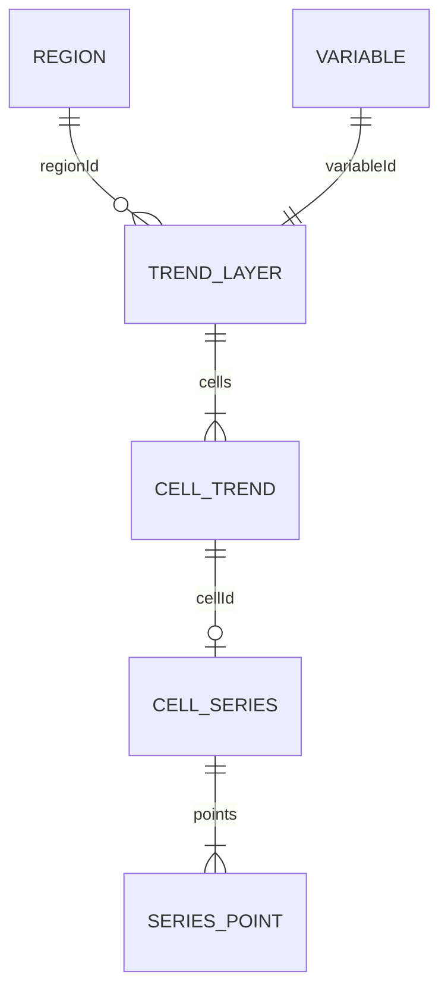

# 3. Database

There is no database. Data lives in JSON files that follow the contract in `web/shared/contracts.ts`:

1. The pipeline export (or the mock) is the input, in `web/server/data/`. Its layout is described in
   `web/server/data/README.md`.
2. The backend validates that input and publishes it as the static API v1 (see 06), which is the output.

Raw NASA downloads stay in the git-ignored `data/` folder at the repo root and never reach the site.

## Entities

## Data dictionary

| Entity | Field | Type | Meaning |
|---|---|---|---|
| Region | `id`, `name` | string | e.g. `amazon` |
| | `boundarySource` | string \| null | Cited boundary source; null until P-008 is decided |
| | `bbox` | [west, south, east, north] | Degrees (WGS84) |
| Variable | `id`, `name` | string | e.g. `ndvi`, "Vegetation greenness (NDVI)" |
| | `description` | string | Plain-language definition for students and the public |
| | `units` | string | Units of the series values (`unitless`, `°C`, …) |
| | `temporalResolution` | `"monthly"` | Only monthly data for now |
| | `period` | {start, end} `"YYYY-MM"` | Period covered |
| | `product` | {shortName, version, provider, doi, kind} | NASA source to cite; `kind` = `satellite` or `model` |
| TrendLayer | `variableId`, `regionId`, `period` | | What and where |
| | `cellSizeDeg` | number | Square cell size in degrees |
| | `method` | {name, description, alpha} | The team's method (free text) and significance level |
| | `summary` | {cellsTotal, cellsTested, cellsSignificant, significantIncreasing, significantDecreasing} | Computed by the backend, never by the pipeline |
| | `dataStatus` | `"mock"` \| `"real"` | Mock data is always labelled in the UI |
| CellTrend | `cellId` | string | Unique per variable, used in URLs and file names |
| | `lat`, `lon` | number | Cell centre |
| | `slopePerDecade` | number \| null | Rate of change in variable units per decade |
| | `pValue` | number \| null | From the team's test; null if not tested |
| | `significant` | boolean | Decided by the pipeline's method (including any multiple-testing correction) |
| | `validMonths` | integer | Non-missing months used |
| CellSeries | `points[]` | {month `"YYYY-MM"`, value number \| null} | Monthly values; null = missing (e.g. clouds), never NaN or -9999 |

Ids match `^[a-z0-9][a-z0-9_-]*$`. Validation rules are in `web/server/validate.ts`.
