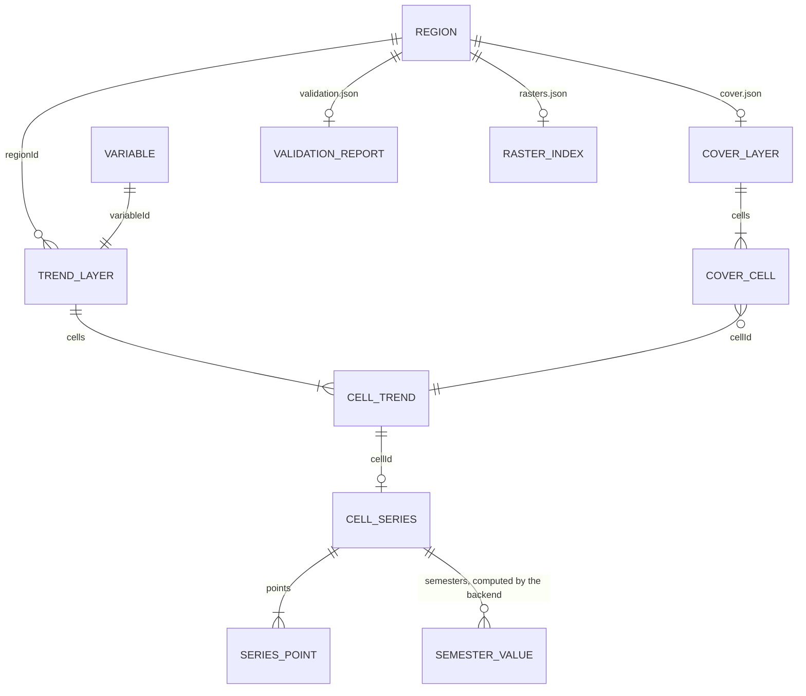

# 3. Database

There is no database. Data lives in JSON files that follow the contract in `web/shared/contracts.ts`:

1. The pipeline export (or the mock) is the input, in `web/server/data/`. Its layout is described in
   `web/server/data/README.md`.
2. The backend validates that input and publishes it as the static API v1 (see 06), which is the output.

Raw NASA downloads stay in the git-ignored `data/` folder at the repo root and never reach the site.

## Entities

## Data dictionary

| Entity | Field | Type | Meaning |
|---|---|---|---|
| Region | `id`, `name` | string | e.g. `amazon` |
| | `boundarySource` | string \| null | Cited boundary source; null until P-008 is decided (the pipeline export names RAISG Biomas 2025, provisionally) |
| | `bbox` | [west, south, east, north] | Degrees (WGS84) |
| Variable | `id`, `name` | string | e.g. `ndvi`, "Vegetation greenness (NDVI)" |
| | `description` | string | Plain-language definition for students and the public |
| | `units` | string | Units of the series values (`unitless`, `°C`, …) |
| | `temporalResolution` | `"monthly"` | Only monthly data for now |
| | `period` | {start, end} `"YYYY-MM"` | Period covered |
| | `product` | {shortName, version, provider, doi, kind} | NASA source to cite; `kind` = `satellite` or `model` |
| | `semesterAggregation` | `"sum"` \| `"mean"` | How the backend combines the months of a six-month period: `sum` for rain and burned area, `mean` otherwise |
| | `slopeUnits` | string (optional) | Units of the trend slope, always "per decade" (e.g. "°C per decade", "mm per year, per decade"). They differ from `units` because the test runs on yearly values |
| | `trendYears` | {start, end} (optional) | First and last year the trend test uses for this variable (NDVI and EVI 2001–2020, LST 2001–2020, rainfall 2001–2024, burned area 2001–2025) |
| TrendLayer | `variableId`, `regionId`, `period` | | What and where |
| | `cellSizeDeg` | number | Square cell size in degrees (1.0 in the pipeline export) |
| | `method` | {name, description, alpha} | The method (free text, written by the pipeline) and significance level. After `trends.py`: "Mann-Kendall trend test on yearly values" (ADR-006). "No trend test applied yet" only before step 8 runs |
| | `summary` | {cellsTotal, cellsTested, cellsSignificant, significantIncreasing, significantDecreasing} | Computed by the backend, never by the pipeline |
| | `dataStatus` | `"mock"` \| `"real"` | Mock data is always labelled in the UI |
| CellTrend | `cellId` | string | Unique per variable, used in URLs and file names (e.g. `r03c07` on the 1° grid) |
| | `lat`, `lon` | number | Cell centre |
| | `slopePerDecade` | number \| null | Sen's slope × 10: change in variable units per decade. `null` when the cell is not tested (fewer than 80 % of its years complete) |
| | `pValue` | number \| null | Raw p-value of the Mann-Kendall test on the yearly values; `null` if not tested |
| | `significant` | boolean | `true` when the Benjamini-Hochberg q-value is below `method.alpha`, per variable (ADR-006). `false` when not tested |
| | `line` | SenLine (optional) | Sen line over the tested years: `{start: {year, value}, end: {year, value}}`, in the units of the yearly value. Only for tested cells |
| | `validMonths` | integer | Non-missing months used |
| CellSeries | `points[]` | {month `"YYYY-MM"`, value number \| null} | Monthly values; null = missing (e.g. clouds), never NaN or -9999 |
| | `semesters[]` | SemesterValue | Six-month periods computed by the backend from `points` (`web/server/periods.ts`), never by the browser |
| SemesterValue | `period` | `"YYYY-H1"` \| `"YYYY-H2"` | H1 = January–June, H2 = July–December |
| | `value` | number \| null | Mean of the valid months ("mean"), or their total ("sum", only when complete). Null if no month is valid |
| | `validMonths` | integer, 0–6 | Months with a value |
| | `complete` | boolean | True only with all six months |
| | `changeVsPreviousYear` | number \| null | Absolute difference (variable units, never a percentage) vs the same half one year earlier. Only when both are complete |
| CellSeries | `annual[]` | AnnualValue | Calendar years computed by the backend from `points` (`web/server/annual.ts`). `value` is the mean of the valid months ("mean") or their total ("sum", only when complete); `complete` only with all 12 months. Used by the area viewer (the trend test works from the monthly values in the pipeline) |
| CoverLayer | `years`, `lossYears`, `burnedYears` | number[] | Years of the tree cover arrays (2000–2025), of the loss arrays (2001–2025) and of the burned arrays (2001–2025) |
| | `definitions` | Record<string, string> | Plain-language definition of each measure |
| | `flags` | {source, year, note}[] | Known problems, e.g. the suspect MOD44B 2025 |
| | `trendMethod` | string (optional) | Plain-language method of the cover trends: years tested, test, FDR, AI disclosure |
| CoverCell | `cellId`, `lat`, `lon` | | Same ids and centres as the trend grid |
| | `hansenTreeCover` | (number \| null)[] | % of the cell: Hansen canopy cover in 2000, then at the end of each year. Never increases |
| | `modisTreeCover` | (number \| null)[] | % of the cell, MOD44B. Reads lower over dense forest |
| | `lossKm2` | (number \| null)[] | km² of stand-replacing loss per year |
| | `burnedKm2` | (number \| null)[] | km² burned per calendar year |
| | `trends` | {lossKm2, modisTreeCover} (optional) | Per measure: `slopePerDecade` (km² per year, or % of cell, per decade), `pValue` (raw), `significant` (after FDR) and `line`. A key is `null` when the cell is not tested. Hansen tree cover is never tested |
| ValidationReport | `meta` | {generatedAt, sources, note, aiDisclosure} | DOI per product short name; the note says that the r values carry no p-value |
| | `trendChecks` (optional) | {generatedUtc, design, variables[], d1Drift, v1FalsePositives, v2Detection, v3KnownPlaces[], v4ZoneTrends} | The only part with p-values and significance: the checks of the trend test (V1–V4, rule D1). Written by `trends.py` |
| | `zones[]` | {zoneId, label, agreement2000, changeVsLoss, lossWithFire, hotspots} | Descriptive cross-checks per zone |
| | `cases[]` | {id, label, lat, lon, reference, apiCellId, years, hansenTreeCover, modisTreeCover, lossYears, hansenLossShare, burnedMonths, burnedMonthsList, burnedPeriod} | A documented place and its citation |
| RasterIndex | `grid` | {west, south, east, north, stepDeg, rows, cols, nodata, row0, col0} | The 0.05° grid shared by all PNG frames |
| | `layers[]` | {id, source, doi, encoding, period?, frames[]} | `encoding` is `percent` or `sqrt_share`; a frame has `key`, `url` and `nMonths` |
| ZonesReport | `zones` | {[zoneId]: {label, variables}} | `amazon`, `amazon_brazil`, `amazon_peru`. Per variable: `units`, `annual[]` (`{year, value, complete}`), `monthlyRange[]` (lowest and highest month per complete year; monthly variables only), `zoneTrend` (`slopePerDecade`, `pValue`, `significant`, `years`, `n`, `line`, `test`; not for Hansen tree cover) and `cellSummary` (`tested`, `significantIncreasing`, `significantDecreasing`). Zone tests are not corrected for multiple testing |
| | `alpha`, `note`, `aiDisclosure`, `generatedUtc` | | Method note and the significance level of the zone tests |
| ManifestExtras | `zones`, `borders` | boolean (optional) | `zones`: `zones.json` is served. `borders`: `public/data/borders.json` exists (a static file, not an API file) |
| BorderCollection | `features[]` | GeoJSON FeatureCollection | Country borders from Natural Earth 10m admin-0 (public domain), clipped to the box and simplified (about 0.02°). Properties `name`, `iso3`. Loaded from `/data/borders.json` |

Ids match `^[a-z0-9][a-z0-9_-]*$`. Validation rules are in `web/server/validate.ts`.

## Pipeline data (input side)

Inputs are NASA and Hansen files downloaded to the git-ignored `data/raw/`. The pipeline (`pipeline/`) turns them into
clips and 0.05° cell statistics in `data/interim/`, and then into:

- the API source in `web/server/data/`: `region.json`, `variables.json`, `trends/`, `series/` (`export_api.py`),
  `cover.json` (`export_cover.py`) and `validation.json` (`validate.py`), in the contract above; then `trends.py` (step 8)
  fills the trend fields, the trends of `cover.json`, `zones.json` and `trendChecks` in `validation.json`;
- extra light files in `web/public/data/`: the JSON files, `validation.json` and the PNG maps (`export_json.py`,
  `export_maps.py`, `validate.py`).

The full source catalog (DOIs, access, licenses, caveats) lives in `data/README.md`.

## Datasets (checked 2026-11-14 and 2026-11-15; variables and methods decided by the team, ADR-006)

| Variable | Product | Units after cleaning | Grid · step | Available | Server-side clip |
|---|---|---|---|---|---|
| NDVI, EVI | `MOD13C2` v061 (LP DAAC) | unitless (raw ÷ 10000, fill −3000) | 0.05° · month | 2000-02 → 2026-10 | No (download global, clip) |
| Land surface temperature day/night | `MOD11C3` v061 (LP DAAC) | °C (raw × 0.02 − 273.15, fill 0) | 0.05° · month | 2000-02 → 2026-10 | No |
| Evapotranspiration, soil moisture | `GLDAS_NOAH025_M` v2.1 (GES DISC) | mm/month; soil moisture mm | 0.25° · month | 2000-01 → 2026-07 | Yes (Harmony, not used yet) |
| Precipitation | `GPM_3IMERGM` v07 (GES DISC) | mm/month | 0.1° · month | 1998-01 → 2025-09 (V07 ends there; V08 pending) | Yes (Harmony, not used yet) |
| Tree cover (% tree, non-tree vegetation, bare ground) | `MOD44B` v061 (LP DAAC) | % (land pixels; water 200 and fill 253 excluded) | 250 m tiles → 0.05° · yearly | 2000–2025 (year Y = early March Y to early March Y+1) | No (tiles, clipped in Python) |
| Burned area | `MCD64A1` v061 (LP DAAC) | share of mapped pixels per cell and month (km² per zone in outputs) | 500 m tiles → 0.05° · monthly | from 2000-11; 2000-11 to 2026-09 processed (2026-10 not yet published by NASA) | No (tiles, clipped in Python) |
| Water storage | `TELLUS_GRAC-GRFO_MASCON_CRI_GRID_RL06.3_V4` (PO.DAAC) | cm equivalent water thickness, anomaly (JPL land scale factors not applied) | 0.5° · month | 2002-04 → 2026-09; 259 months, 35 missing | No (one file, clipped in Python) |
| Forest cover and loss | Hansen/UMD GFC v1.13 (GFC-2025), `treecover2000`, `lossyear` (Google Cloud Storage, no login) | % canopy cover in 2000; loss share per year; canopy-weighted loss for tree cover | 30 m → 0.05° · yearly | 2000 (cover); loss 2001–2025 | Not applicable (GeoTIFF tiles) |

Boundaries: RAISG *Biomas 2025* (record `id_bioma = 1`, latin-1 text, SIRGAS 2000), HydroBASINS v1c level 3
(`PFAF_ID = 622`, WGS84), Natural Earth 10m countries (`ADM0_A3`, public domain, auto-downloaded).

## Files

| Path | Content | In git |
|---|---|---|
| `data/raw/<SHORT_NAME>/` | NASA global files as downloaded (monthly products) | No |
| `data/raw/MOD44B/<YYYY>/`, `data/raw/MCD64A1/<YYYY-MM>/` | tiles of one period; deleted after aggregating | No |
| `data/raw/HANSEN/` | GeoTIFFs of one 10° tile (`treecover2000`, `lossyear`); `.part` while downloading; deleted after aggregating | No |
| `data/raw/GRACE/` | GRACE global NetCDF; deleted after clipping | No |
| `data/raw/boundaries/` | boundary zips: `Biomas_2025.zip`, `hybas_sa_lev03_v1c.zip`, `ne_10m_admin_0_countries.zip` (Natural Earth, auto-downloaded if missing) | No |
| `data/interim/<SHORT_NAME>/<YYYY-MM>.nc` | one month clipped to lat −21..10.5, lon −80..−43; lat/lon ascending | No |
| `data/interim/logs/<SHORT_NAME>.log` | download and clip log, one per product (one process per product) | No |
| `data/interim/MOD44B/<YYYY>.nc` | tree cover statistics per 0.05° cell, one product year (`tree_cover`, `tree_cover_sd`, `nontree_veg`, `nonvegetated`, `n_250m_land`, `water_share`) | No |
| `data/interim/MCD64A1/<YYYY-MM>.nc` | `burned_share`, `burn_day_mean`, `n_500m_mapped` per 0.05° cell, one month | No |
| `data/interim/HANSEN/tiles/<tile>.npz` | Hansen result for one 10° tile (resumable) | No |
| `data/interim/HANSEN/gfc_v1.13.nc` | `treecover2000`, `loss_share` (years 2001–2025), `canopy_loss` and `tree_cover` per 0.05° cell | No |
| `data/interim/GRACE/tws.nc` | `tws` (cm) and `tws_uncertainty` on the 0.5° grid, one entry per calendar month | No |
| `data/interim/masks/<boundary>_<step>_<rows>x<cols>.nc` | cached zone masks per grid | No |
| `web/server/data/` | API source: `region.json`, `variables.json`, `trends/<id>.json`, `series/<id>.json` (`export_api.py`: 566 cells of 1°, five variables; trend fields filled by `trends.py`); `cover.json` (`export_cover.py`, `trends.py`); `validation.json` (`validate.py`, camelCase; `trendChecks` from `trends.py`) | Planned (P-023) |
| `web/server/data/zones.json`, `web/public/data/borders.json` | Yearly values, monthly ranges and zone trends per zone (`trends.py`, step 8); country borders (`export_borders.py`, step 9) | Planned (P-023) |
| `web/public/data/amazon_monthly.json` | monthly zone values (2001-01 onward) | Planned (P-023) |
| `web/public/data/amazon_semester.json` | the same values per six-month period (`YYYY-H1`, `YYYY-H2`) | Planned (P-023) |
| `web/public/data/amazon_annual.json` | yearly tree cover (MOD44B), Hansen cover 2000 and loss, burned area | Planned (P-023) |
| `web/public/data/validation.json` | cross-validation sections per zone, snake_case (results of the 15 Nov run in `pipeline/README.md`, *Cross-validation*) | Planned (P-023) |
| `web/public/data/maps/index.json`, `maps/**/*.png` | 0.05° map layers as 8-bit PNG data images | Planned (P-023) |

Clipped grids: 630 × 740 (0.05°), 315 × 370 (0.1°), 126 × 148 (0.25°), 63 × 74 (0.5°, GRACE).

## JSON schemas (web outputs)

**`amazon_monthly.json`, `amazon_semester.json`, `amazon_annual.json`** (written by `pipeline/export_json.py`) share `meta`,
`zones` and `variables` (`series` differs).

- `meta`: project, `generated_utc`, `amazon_boundary`, `clip_box`, `analysis_start` (2001-01), `lst_last_month`
  (2020-12), `semesters`, `mod13c2_accepted_reliability`, `method`, `sources`.
- `zones.<id>`: `label`, `cells_0.05deg`, `area_km2`. Ids: `amazon`, `amazon_brazil`, `amazon_peru`.
- `variables.<id>`: `source` (product or source name), `doi`, `units`, `description`, `kind` (`data`, `context` or
  `diag`), `zone_statistic` (`mean` or `area`), `semester_aggregation` (`mean` or `sum`).
- Monthly `series.<zone>.<variable>`: `t` (`YYYY-MM` strings), `mean` (or `total` for `burned_area`, km²; null when no
  valid cell), and for `data` and `context` variables `valid_share` (fraction of zone cells with a value).
- Semester `series.<zone>.<variable>`: `t` (`"YYYY-H1"` / `"YYYY-H2"`), `value`, `n_months`, `aggregation`.
- Annual `series.<zone>.<variable>`: `t` as numbers (years); `mean` for the MOD44B and Hansen cover series; `total` for
  `hansen_loss_area` (2001–2025) and `burned_area` (complete years only).

Variables. `data`: `ndvi`, `evi`, `lst_day`, `lst_night`, `burned_area`. `context`: `et`, `soil_moisture_0_10cm`,
`precip`, `water_storage`. `diag`: `ndvi_good_share`, `lst_clear_days`, `lst_day_local_time`, `rain_gldas`.

**`validation.json`, two copies:**

- `web/public/data/validation.json` (snake_case, `pipeline/validate.py`): `meta` (`generated_utc`, `sources` (DOIs of
  MOD44B, Hansen, MCD64A1), `note`, `ai_disclosure`); `zones.<id>`: `agreement_2000` (r, cells, bias, RMSE,
  `by_hansen_class`), `change_vs_hansen_loss` (r, cells, definition, `by_hansen_loss_decile`), `loss_with_fire`
  (definition, per year: loss km², loss in burned cells, share, zone share of cells burned), `hotspots` (ten per zone:
  lat, lon, `api_cell_id`, loss share, peak year and share, cover 2000, MOD44B change, burned years) and
  `yearly_zone_means`; `cases` (one per documented place: Hansen and MOD44B cover, Hansen loss share, burned months).
- `web/server/data/validation.json` (camelCase, the API's `ValidationReport`): `meta` (`generatedUtc`, `sources`, `note`,
  `aiDisclosure`), `zones[]` (`zoneId`, `label`, `agreement2000`, `changeVsLoss`, `lossWithFire`, `hotspots`) and `cases[]`.
  Outside `trendChecks` it holds no p-values and no significance fields; the server rejects them.

**`web/server/data/cover.json`** (`export_cover.py`, trends from `trends.py`): `cellSizeDeg`, `years` (2000–2025), `lossYears` and `burnedYears`
(2001–2025), `definitions`, `flags`, `trendMethod` and `cells[]` (see *Data dictionary*, CoverCell).

**`web/server/data/zones.json`** (`trends.py`): `note`, `alpha`, `generatedUtc`, `aiDisclosure` and `zones` keyed by
`amazon`, `amazon_brazil` and `amazon_peru`. Yearly values come from the area-weighted zone series
(`amazon_monthly.json`, `amazon_annual.json`). Lowest and highest month per year are information only, never tested.
Hansen tree cover is shown but not tested. Served at `/api/v1/zones.json` when present (`manifest.extras.zones`).

**`web/public/data/borders.json`** (`export_borders.py`): GeoJSON FeatureCollection of the countries that touch the clip box,
Natural Earth 10m admin-0 (public domain). Static file, not part of the API (`manifest.extras.borders`).

**`maps/index.json`** (written by `pipeline/export_maps.py`)

- `grid`: `lat_min`, `lat_max`, `lon_min`, `lon_max`, `step_deg` (0.05), `row0` ("north"), `col0` ("west"), `nodata`
  (255), `rows`, `cols`.
- `encodings`: `percent` and `sqrt_share` (share = (value / 100)²).
- `layers.<name>`: `source`, `doi`, `encoding`, `period`, `files` (year or half-year → PNG path relative to `maps/`).
  Layers: `tree_cover` (MOD44B, percent, 2000–2025), `hansen_treecover2000` (percent, 2000), `hansen_loss` (sqrt_share,
  2001–2025), `hansen_tree_cover` (percent, end of each year 2001–2025), `burned` (sqrt_share, `YYYY-H1`/`YYYY-H2`, with
  `n_months`). When the API is built, `rasters.json` puts the 2000 frame of `hansen_treecover2000` into
  `hansen_tree_cover`.

## Invariants

- Means are weighted by cos(latitude) and use only cells whose center is inside the zone polygon. Burned area is
  summed as km² (burned share × cell area), not averaged.
- Nothing is dropped for quality during clipping; the only quality filter is `MOD13C2_ACCEPTED_RELIABILITY`
  at export, and its effect is exported as `ndvi_good_share`.
- Team rules applied at export (decided 2026-11-15, `pipeline/config.py`):
  - C1: series start at `ANALYSIS_START` = 2001-01 (February 2000 is a partial month).
  - B1: `lst_day` and `lst_night` stop at `LST_LAST_MONTH` = 2020-12 (Terra orbit drift). The diagnostics
    `lst_clear_days` and `lst_day_local_time` are not cut.
  - D1: GLDAS evapotranspiration (`et`) is kind `context`, not a forest indicator.
  - Semesters: H1 = January–June, H2 = July–December (`SEMESTERS`). Semester aggregation is `sum` for precipitation,
    ET, rain forcing and burned area, `mean` otherwise.
- MOD44B: only land pixels (values 0–100) are used; water (200) and fill (253) are excluded. MCD64A1: mapped pixels are
  `Burn Date` ≥ 0. Hansen: loss share = share of the cell's 200 × 200 Landsat pixels with loss in that year. Hansen tree
  cover is canopy-weighted: each lost pixel counts with its 2000 cover (`canopy_loss`).
- Burned cells in validation: a cell counts as burned in a year when its MCD64A1 burned share is above 0 in at least one
  month of that calendar year; only complete years 2001–2025 are used.
- Semesters (computed by the backend, `web/server/periods.ts`): a semester is `complete` only with six valid months; a
  "sum" value is null unless complete; a change vs the previous year is only given when both halves are complete.
- Cover (checked at build): the cell ids, centres and years are those of the trend grid; Hansen tree cover stays within
  0–100 and never increases.
- Missing GRACE months are absent from `t`, not null.
- Map PNGs are not cut to the Amazon polygon (license of the RAISG boundary); the zone values in the JSON are.
- Trend results (ADR-006) are written only by `pipeline/trends.py`, the last step that writes them. Before it runs,
  `export_api` writes `slopePerDecade` and `pValue` as null and `significant` as false.
- A cell is tested only with at least 80 % of its variable's years complete. Hansen tree cover is never tested.
- `significant` is decided after the Benjamini–Hochberg correction, per variable (cover loss and MODIS separately).
  `pValue` is the raw p-value. The browser shows these values and computes none of them.
