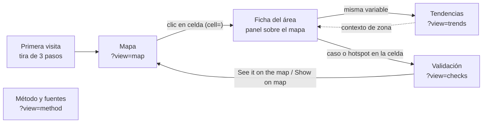

<!-- AI-assisted: drafted with Claude (Anthropic) via Claude Code on 2026-11-15 from an Opus 5.5 review; reviewed by the team. Internal planning document (Spanish). -->

# Plan de UX/UI de SIGNO

> **Estado:** Propuesta. No se implementa nada hasta responder las preguntas de la sección 1.

| | |
|---|---|
| **Fecha** | 15 de noviembre de 2026. Hoy es el día de la entrega: domingo 15 de noviembre, 23:59 hora de Lima. |
| **Para** | Alexis (datos y semántica) y José (diseño visual y frontend). Lectura de nivel técnico medio. |
| **Decide** | El equipo. José aprueba el diseño de cada fase. Alexis aprueba el significado de los datos. |
| **Origen** | Revisión de UX/UI hecha con Claude (Opus 5.5) el 15 de noviembre de 2026, a partir de las capturas 01 a 12. |

**Cómo usar este documento**

1. Lee el resumen (sección 2).
2. Responde las preguntas de la sección 1 en los espacios "Respuesta". Si no hay respuesta, la recomendación queda como propuesta y no se implementa.
3. Revisa las secciones 3 a 9: estado actual y diseño propuesto, vista por vista.
4. Aprueba las fases de la sección 10 una a una, con una captura de pantalla.
5. Las reglas de la sección 11 no se negocian en el diseño.

**Convenciones**

- Las cadenas de interfaz se citan en inglés, como aparecen en el producto. Este documento es interno y va en español. Lo entregable va en inglés.
- Los corchetes, por ejemplo `[primary-action]`, son reglas de la guía ui-ux-pro-max. "FD" es la guía frontend-design. Ver sección 12.
- Los números usan coma decimal. Las coordenadas y los identificadores se escriben como están en el código.
- Las rutas de archivos son relativas a `web/`, salvo que se indique otra cosa.

---

## 1. Preguntas obligatorias antes de implementar

Responde cada pregunta en su espacio. Cada una indica quién decide: **José** (diseño y frontend), **Alexis** (datos y backend) o **Equipo** (todos).

### 1. Navegación entre vistas · José

- **Pregunta:** ¿Cómo se separan las vistas del sitio?
- **Opciones:** a) pestañas con `?view=`, sin dependencias nuevas; b) react-router; c) mantener los drawers.
- **Recomendación:** a).
- **Respuesta:** ____________________

### 2. Tipos de mapa · Equipo (Alexis: exportación; José: interfaz)

- **Pregunta:** ¿Qué tipos de mapa entran?
- **Opciones:** a) solo cobertura, pérdida y fuego; b) lo anterior más "lost since 2000", que requiere que el pipeline exporte ese dato; c) mantener MODIS en el mapa.
- **Recomendación:** a). Añadir "lost since 2000" después, si se exporta.
- **Respuesta:** ____________________

### 3. Mapa por defecto · José

- **Pregunta:** ¿Qué se ve al entrar?
- **Opciones:** a) cobertura Hansen 2025; b) pérdida del último año; c) inicio guiado con La Pampa.
- **Recomendación:** a), con el botón de La Pampa visible.
- **Respuesta:** ____________________

### 4. Grano por defecto · José

- **Pregunta:** ¿Qué capa es la principal?
- **Opciones:** a) raster de 0,05° visible, con una rejilla de 1° para seleccionar; b) solo 1°.
- **Recomendación:** a).
- **Respuesta:** ____________________

### 5. Decodificar en el navegador · Alexis, con el equipo

- **Pregunta:** ¿Puede el navegador decodificar los valores de los PNG (`sqrt_share` → proporción) para mostrarlos? ¿Eso es presentación o cálculo?
- **Opciones:** a) sí, se documenta en un ADR y el navegador no agrega nada; b) no: el backend exporta los valores ya decodificados.
- **Recomendación:** a).
- **Respuesta:** ____________________

### 6. Modo de tendencia en el mapa · José

- **Pregunta:** Mientras no exista el método, ¿se oculta el modo de tendencia o se muestra deshabilitado con una explicación?
- **Opciones:** a) ocultarlo en el mapa (Tendencias lleva la nota "test pending"); b) mostrarlo deshabilitado (`empty-nav-state`).
- **Recomendación:** a).
- **Respuesta:** ____________________

### 7. Fuente de datos de Tendencias · Alexis (backend) y José

- **Pregunta:** ¿Cómo llegan los datos de Tendencias a la web?
- **Opciones:** a) un archivo nuevo de API v1, `zones.json`, validado en el backend como exige ADR-004; b) leer `public/data` directamente desde el navegador.
- **Recomendación:** a).
- **Respuesta:** ____________________

### 8. Qué puede mostrar Tendencias sin el test · Equipo

- **Pregunta:** ¿Qué se muestra mientras el equipo no tenga el test de tendencia?
- **Opciones:** a) solo valores crudos; b) valores crudos y líneas del mismo semestre; c) además, marcadores de sequías documentadas (solo si el equipo cita las fuentes).
- **Recomendación:** la revisión no da una recomendación firme. Sugerencia: b).
- **Respuesta:** ____________________

### 9. MODIS (MOD44B) · Equipo

- **Pregunta:** ¿Dónde va MODIS?
- **Opciones:** a) fuera del mapa; b) en el mapa, como casilla de "check", con 2024 por defecto.
- **Recomendación:** a). MODIS se mantiene en el gráfico de la ficha y en Validación.
- **Respuesta:** ____________________

### 10. Opacidad por defecto · José

- **Pregunta:** ¿Qué opacidad inicial tienen las capas?
- **Opciones:** a) raster al 70 % y celdas de 1° al 50 %, con un deslizador de 0 a 100 %; b) otros valores.
- **Recomendación:** a).
- **Respuesta:** ____________________

### 11. Color y tipo del fuego · José

- **Pregunta:** ¿El fuego es un tipo de mapa aparte o una superposición sobre la pérdida? ¿Qué tono usa?
- **Opciones:** a) tipo aparte, con tono propio; b) superposición sobre la pérdida.
- **Recomendación:** a). José elige el tono. Debe distinguirse de la pérdida, que es naranja.
- **Respuesta:** ____________________

### 12. Selector de variables · José

- **Pregunta:** ¿El selector de variables se mueve a las pestañas de la ficha y a Tendencias?
- **Opciones:** a) sí; b) no, se queda en la columna izquierda.
- **Recomendación:** a). La columna izquierda ocupa hoy un quinto del ancho.
- **Respuesta:** ____________________

### 13. Idioma · Equipo

- **Pregunta:** ¿Solo inglés, o inglés y español?
- **Opciones:** a) solo inglés; b) inglés y español.
- **Recomendación:** a).
- **Respuesta:** ____________________

### 14. Aprobación de fases · Equipo

- **Pregunta:** ¿José aprueba cada fase con una captura de pantalla, y Alexis aprueba el significado de los datos? ¿Basta una ventana de 15 minutos?
- **Opciones:** a) sí, 15 minutos por fase; b) otra ventana.
- **Recomendación:** la revisión no da una recomendación. Hay que confirmarlo.
- **Respuesta:** ____________________

### 15. Tiempo y alcance · Equipo

- **Pregunta:** ¿Se congela el código a las 20:00 (Lima) y se graba la demo después? ¿Se entrega solo la fase 1, y la fase 2 solo si 1a a 1e están terminadas?
- **Contexto:** la entrega es hoy, a las 23:59 (Lima). La fase 1 suma 7,5 a 8 horas de esfuerzo estimado. La fase 2 suma 4 a 5 horas.
- **Recomendación:** sí a las dos cosas.
- **Respuesta:** ____________________

### 16. Datos reales · Alexis y José

- **Pregunta:** ¿Qué PNG se versionan (P-023)? ¿Se hace el cambio a datos reales en Vercel (P-009) antes del trabajo de UI?
- **Opciones:** a) versionar todo, incluidos los PNG de MOD44B (5,6 MB); b) versionar sin los PNG de MOD44B, lo que reduce P-023.
- **Recomendación:** versionar primero, antes de la UI.
- **Respuesta:** ____________________

### 17. Barra superior · José (y Kiara para la presentación)

- **Pregunta:** ¿Se mantiene "Present" y se mueve "Data" a Método?
- **Opciones:** a) sí; b) no.
- **Recomendación:** a). "Present" es útil para el pitch.
- **Respuesta:** ____________________

---

## 2. Resumen ejecutivo

- **El problema principal está en el mapa.** Las celdas de 1° están al 85 % de opacidad y tapan la imagen. A zoom 8 se ven bloques de color sin contexto (captura 07). Es el problema más grave.
- **La celda de 1° diluye La Pampa.** En una celda de 1° (unos 12.000 km²), la cobertura de 2025 aparece como 88,4 %. El píxel de 0,05° da 23,0 %. Las capas de 0,05° resuelven esto: el usuario ve el detalle en vez del promedio de la celda.
- **Hallazgo técnico 1: los PNG de 0,05° guardan valores, no colores.** Son imágenes de 8 bits en escala de grises (740 × 630 píxeles, nodata 255). La pérdida y el fuego se guardan como `sqrt_share`. El navegador debe decodificarlos y pintarlos en un canvas.
- **Hallazgo técnico 2: los PNG necesitan reproyección.** Están en una rejilla lat/lon simple, y el mapa usa Web Mercator. Sin corregir, se desplazan hasta 0,24° (unos 5 píxeles PNG, peor cerca de 10,6° S). Hay que reproyectar las filas antes de pintar.
- **Estructura propuesta:** cuatro vistas con `?view=` (Mapa, Tendencias, Validación y Método). La ficha del área sigue siendo un panel sobre el mapa.
- **Qué se quita:** la columna izquierda "Variable", el modo de tendencia vacío (PuOr), MODIS del mapa, α = 0,05 y el p-value.
- **Qué sube de prioridad:** la validación, hoy escondida en un cajón de 650 px, y el gráfico de pérdida de La Pampa (de 7,7 a 87,6 km²/año), que hoy queda debajo del pliegue.
- **Orden de trabajo:** primero las respuestas de la sección 1, sobre todo la 16 (datos reales). Después, la fase 1 (7,5 a 8 h estimadas). La fase 2 solo si la fase 1 está lista.

---

## 3. Estado actual, vista por vista (sección A)

| Vista | Qué hace hoy | Problemas (captura) | Gravedad |
|---|---|---|---|
| Primera visita | Tarjeta de bienvenida sobre el mapa | La tarjeta tapa la barra del mapa (01). En móvil cubre todo el mapa (10). Muestra "566 cells / pending" pero no dice cuál es el siguiente paso hacia la evidencia. | Media |
| Columna izquierda "Variable" | 5 tarjetas largas, selector de periodo, mapa base y leyenda | Ocupa un quinto del ancho y 900 px de alto (01). No cambia nada en el mapa de portada. Elegir EVI o Burned area da la misma ficha visible (capturas 05 y 06). | Alta |
| Mapa, cobertura arbórea | Celdas de 1°, Hansen/MODIS, deslizador de año | Las celdas están al 85 % de opacidad y tapan la imagen (02). A zoom 8 la pantalla son bloques de color planos, sin contexto, con efecto de mareo (07). La rejilla de 1° diluye La Pampa a 88,4 % (05). El mapa MODIS es un verde medio uniforme y engaña (03). | **Crítica** |
| Mapa, tendencia | Clases PuOr | Todas las celdas salen en gris (04). Es un modo vacío que se ofrece como opción. | Alta |
| Ficha del área | Sello, métricas, portada, pérdida, quemado, tabla, serie, comparación de seis meses, acciones | "Significance level α = 0.05" y "p-value not tested" se muestran sin ningún test (05; también `MethodDrawer.tsx:91` y `TrendSummaryPanel.tsx:57`). Primero van los números y luego su significado. El gráfico más útil (la pérdida que sube de 7,7 a 87,6 km²/año) queda debajo del pliegue. La serie de la variable elegida está casi al final (12). A los usuarios se les muestra una nota interna de backlog ("MapBiomas pending"). | Alta |
| Validación (cross-checks) | Una pestaña dentro de un cajón de 650 px | Es el contenido más sólido, pero está oculto tras un diálogo. La Pampa queda al final de tablas largas (07) [`modal-vs-navigation`, `drawer-usage`]. | Alta |
| Método | Pestaña del cajón | Dice sobre todo "No trend test applied yet" (08). Como material de referencia está bien. | Baja |
| Modo oscuro | Cambio de tokens | Se ve coherente (09). Falta comprobar el contraste del segmento seleccionado y de las celdas sobre la imagen (P-025) [`color-dark-mode`]. | Media |
| Móvil | Página apilada | La navegación ocupa dos filas. El mapa mide unos 360 px de alto y su barra cubre cerca del 45 % (11). La página mide 4.000 px de largo (12) [`content-priority`]. | Alta |

---

## 4. Arquitectura de información y flujo (sección B)

Hay cuatro vistas, elegidas con `?view=` en la barra superior. La vista actual queda resaltada [`nav-state-active`, `navigation-consistency`]. Al cambiar de vista, el foco pasa a `<main>` [`focus-on-route-change`].

| Vista (`?view=`) | Pregunta que responde |
|---|---|
| **Mapa** (`map`, la vista por defecto) | ¿Dónde está la cobertura arbórea, dónde se perdió y dónde se quemó, en el año Y? |
| **Tendencias** (`trends`) | ¿Cómo cambiaron el Amazonas, Brasil y Perú de 2001 a 2026, variable por variable? |
| **Validación** (`checks`, cross-checks) | ¿Se puede confiar en estos datos? |
| **Método y fuentes** (`method`) | ¿Cómo se hizo, con qué datos y con qué límites? También reúne los enlaces "Data/API". |

- **La ficha del área es un panel sobre el Mapa, no una vista aparte.** Se abre con `cell=` [`deep-linking`].
- **Enlaces entre vistas:**
  - Un caso de Validación lleva al Mapa (capa, año, zoom y celda abierta).
  - La ficha lleva a Tendencias (misma variable; contexto de la zona).
  - La ficha lleva a Validación cuando un caso o hotspot cae dentro de la celda.
- **Los enlaces antiguos siguen funcionando.** Un enlace sin `view` abre el Mapa.
- **Primera visita:** una tira pequeña que se puede cerrar reemplaza la tarjeta de bienvenida: "1 Choose a map · 2 Click an area · 3 Check the evidence". El botón principal dice "Start with a documented case: La Pampa mining, Peru". Hay opciones Skip y Back, y un solo botón principal [`primary-action`]. La numeración se usa porque los pasos sí son una secuencia (FD).

Diagrama del flujo entre vistas:

---

## 5. Vista Mapa (sección C)

### 5.1 Tipos de mapa

| Tipo | Datos | Decisión | Motivo |
|---|---|---|---|
| Cobertura arbórea (Hansen), 2000 a 2025 | PNG `hansen_tree_cover` y `treecover2000` (0,05°); `cover.json` (1°) | **Mantener** | Es la línea base. No puede subir, porque no cuenta el rebrote. La leyenda lo dice. |
| Pérdida de cobertura en el año Y (Hansen), 2001 a 2025 | PNG `hansen_loss` (`sqrt_share`); `lossKm2` (1°) | **Mantener** | Aquí se ve la actividad. La Pampa se ilumina en 2014. Se rotula "loss (fire, logging, mining, clearing)", nunca "deforestación". |
| Área quemada por semestre, de 2001-H1 a 2026-H2 | PNG `burned` (única fuente por semestre); el dato de 1° es solo anual | **Mantener** | Permite el control por semestre. 2026-H2 (3 de 6 meses) va en gris y rotulado. Se escribe "coincides with", nunca "caused". |
| Cobertura perdida desde 2000 | No exportada. El navegador no debe calcularla. | **Después** | Solo si el pipeline la exporta (pregunta 2). |
| MODIS MOD44B | Lee 22 puntos por debajo de Hansen. 2025 está marcado como sospechoso. | **Quitar del mapa** | Se mantiene en el gráfico de la ficha y en Validación. |
| Tendencia (PuOr) | Todos los valores son nulos. | **Ocultar** | Hasta que exista el método del equipo (pregunta 6). |
| NDVI, EVI, LST y lluvia por celda | No existe capa por periodo. | **Quitar** | Estas variables van a Tendencias y a la ficha. |

### 5.2 Controles

La barra del mapa va arriba a la izquierda, en una sola fila en escritorio.

- **Tipo de mapa:** tres segmentos.
- **Tiempo:** un deslizador de año para cobertura y pérdida; un paso de semestre para el fuego.
- **Popover "Layers":** mapa base y deslizador de opacidad.

### 5.3 Grano

- El raster de 0,05° es la capa visible en todos los zoom.
- La rejilla de 1° es la capa de selección: contornos finos que se engrosan al pasar el cursor. La celda elegida se marca con el color de acento.
- El interruptor "Summary 1°" rellena las celdas de 1° en lugar del raster. Sirve para la vista general y para navegar con teclado.
- Las imágenes se dibujan pixeladas. Los valores nodata y cero se dibujan transparentes.

### 5.4 Transparencia

- Opacidad por defecto: raster al 70 % y relleno de 1° al 50 %. El deslizador va de 0 a 100 %.
- El relleno nunca baja de 0,2 [`opacity-threshold`].
- En las capas de pérdida y fuego, el cero es transparente. Así el mapa base se ve casi en todas partes.

### 5.5 Leyenda

- Siempre visible, abajo a la izquierda. Una leyenda por tipo de mapa, con unidades [`legend-visible`, `color-not-only`].
- Cobertura: rampa verde (como hoy).
- Pérdida: rampa de un solo tono naranja, para mantener la regla "naranja = disminución".
- Fuego: necesita un tono propio, para no confundirse con la pérdida. Lo elige José (pregunta 11).

### 5.6 Interacción

- Al pasar el cursor o enfocar una celda, se actualiza la lectura: el valor de 1° y el valor del píxel de 0,05° bajo el cursor. En móvil, el toque hace lo mismo [`hover-vs-tap`, `tooltip-keyboard`].
- El clic abre la ficha del área.
- Las flechas del teclado siguen moviendo por la rejilla.
- La alternativa de la guía para mapas coropléticos (una tabla ordenable) va en la ficha y en Validación.

### 5.7 Móvil

- El mapa ocupa 60 dvh, con una barra plegable de una fila.
- La ficha se convierte en una hoja inferior (bottom sheet) [`viewport-units`, `touch-target-size`].

---

## 6. Vista Tendencias (sección D)

**Datos.** Vienen de `public/data/amazon_annual.json`, `amazon_semester.json` y `amazon_monthly.json`, con 3 zonas. Según la pregunta 7, se deben servir desde un archivo nuevo de API v1, `zones.json`, validado en el backend como exige ADR-004.

**Componentes:**

1. **Panel forestal.** Tres gráficos pequeños, con el mismo eje de años, apilados y no con doble eje [`data-density`, `chart-type`]:
   - cobertura Hansen (línea);
   - pérdida en km² (barras);
   - área quemada en km² (barras).
2. **Panel de clima y verdor.** Un gráfico pequeño por variable: NDVI, EVI, LST diurna (termina en 2020, con el final marcado) y lluvia (termina en 2025-09).
   - Cada gráfico dibuja H1 y H2 como dos líneas separadas: una sólida y otra discontinua, con etiquetas directas, nunca solo por color [regla de la misma mitad].
   - Los semestres incompletos se dibujan vacíos (huecos).
   - El botón "Monthly" muestra el detalle estacional, con los huecos visibles [`time-scale-clarity`].
3. **Selector de zona:** Amazon, Brazil, Peru. Se muestra como líneas superpuestas (3 series, dentro del límite de 6) o como columnas.
4. **Vista general "Everything".** Una cuadrícula compacta con todas las variables de una zona, en un solo eje de tiempo. Sirve para ver que las caídas ocurren juntas, por ejemplo en años de sequía. El pie dice "together is not cause" (juntos no es causa). Al hacer clic en una fila, se expande.

**Lo que es honesto sin el test del equipo:**

- Solo valores crudos. Nada de líneas ajustadas, pendientes, flechas ni la palabra "tendencia".
- Nota fija: "Descriptive values. The team's trend test is not applied yet."
- Marcadores de años de sequía documentados, solo si el equipo cita fuentes (pregunta 8).
- Cada gráfico tiene un resumen en texto y una tabla de valores [`screen-reader-summary`, `data-table`], y un enlace CSV/JSON [`export-option`].

---

## 7. Ficha del área o celda (sección E)

**Veredicto: útil. Se mantiene.** Es el paso de "compruébalo tú mismo" para estudiantes. Incluso a 1°, la pérdida de La Pampa, que sube de 7,7 a 87,6 km²/año, es evidencia clara.

**Nuevo orden** [`progressive-disclosure`]:

1. **Cabecera:** coordenadas y luego "1° area (~12,000 km²)". El ID de la celda pasa a texto pequeño.
2. **Resumen en lenguaje sencillo, primero**, con valores del backend. Ejemplo: "Tree cover 97.0 % (2000) → 88.4 % (2025, Hansen). Loss 87.6 km² in 2025. Burned area small." Si se quiere "el año con más pérdida", el backend debe darlo.
3. **Insignia del caso documentado**, si la celda tiene un caso o un hotspot: "La Pampa (MAAP #233): 99.6 → 23.0 % at 0.05°", con enlace a Validación.
4. **"Inside this area at 0.05°":** miniatura de 20 × 20 píxeles de la capa y el año actuales. Esto resuelve el problema de la dilución.
5. **Gráficos:**
   - línea de cobertura Hansen (MODIS como línea discontinua, en una casilla "check", marcada como 2025);
   - barras de pérdida y de área quemada, sobre el mismo eje x.
6. **Pestañas de variables:** NDVI, EVI, LST, Rain y Burned. Reemplazan la columna izquierda, muestran la serie mensual e incluyen la comparación de seis meses.
7. **Plegado al final:** calidad de datos (meses válidos), tabla de valores y descargas (Series JSON, Copy link).

**Se quita:** α, el p-value, la fila "Trend: not computed yet", el sello discontinuo y la nota de MapBiomas. El sello se sustituye por una sola línea de estado: "Trend test: pending (team decision)".

**Se agrega:** el resumen al inicio, la insignia del caso, la miniatura de 0,05°, las pestañas de variables y la línea de estado.

---

## 8. Vista Validación / Cross-checks (sección F)

Hoy es una pestaña dentro del cajón. Pasa a ser una vista propia (fase 1a). Cada sección es una pregunta. Su respuesta, en una línea, va antes de la evidencia. Arriba hay un selector de zona (Amazon, Brazil, Peru).

1. **"Does SIGNO find a documented case?"** (¿SIGNO encuentra un caso documentado?). La historia de La Pampa:
   - líneas de Hansen y MODIS (99,6 → 23,0 %; 79,6 → 5,4 %);
   - barras de la proporción de pérdida, con pico en 2014 (24,4 %);
   - "No burned months: loss without fire" (sin meses quemados: pérdida sin fuego);
   - la cita MAAP #233;
   - "See it on the map" (capa de pérdida, 2014, zoom 8, 0,05°).
2. **"Do two independent datasets agree?"** (¿coinciden dos fuentes independientes?). r = 0,88, sin valor p. Un gráfico de mancuerna (dumbbell) de Hansen contra MODIS por clase, con la nota "MODIS reads 22 pts lower" (MODIS lee 22 puntos menos).
3. **"Does MODIS see change where Hansen sees loss?"** (¿MODIS ve cambio donde Hansen ve pérdida?). Barras por decil; r = −0,72.
4. **"Where loss and fire coincide"** (dónde coinciden pérdida y fuego). Pérdida en celdas quemadas frente a la tasa base, por año. El pie dice "coincide, not cause" (coincide, no causa).
5. **Hotspots:** tabla ordenable. Cada fila tiene "Show on map" (mostrar en el mapa).

---

## 9. Accesibilidad, responsive, rendimiento y textos (sección G)

**Accesibilidad**

- Contraste AA comprobado en los dos temas, incluida la leyenda sobre la imagen.
- Foco visible. Áreas de toque de al menos 24 px en web y 44 px en táctil.
- El raster tiene un `aria-label` con el resumen. La rejilla conserva su modelo de teclado.
- Con movimiento reducido se desactivan el barrido y la animación de vuelo (fly-to).

**Responsive**

- Puntos de corte: 375, 768, 1024 y 1440 px.
- En móvil, la navegación es una fila desplazable o un menú.

**Rendimiento**

- Cargar solo el fotograma actual: cobertura Hansen unos 212 KB, pérdida unos 140 KB, quemado unos 50 KB.
- Precargar el fotograma siguiente y el anterior.
- Decodificar con `createImageBitmap`. Caché de como máximo 8 fotogramas decodificados (1,9 MB cada uno).
- Cargar en diferido las vistas de Tendencias y Validación [`bundle-splitting`].
- Cargar los datos mensuales por zona solo cuando hagan falta (248 KB).
- No versionar los PNG de MOD44B (5,6 MB) reduciría P-023 (pregunta 16).

**Textos (copy)**

- En inglés, con mayúscula inicial de frase. Los títulos son preguntas. Cada número lleva unidad.
- Decir "loss", nunca "deforestation". Decir "coincides", nunca "caused". Decir "descriptive", nunca "significant".
- Solo diferencias absolutas.
- Opcional, decide José: suavizar las etiquetas en mayúsculas y monoespaciadas (FD).

---

## 10. Plan por fases (sección H)

**Requisito previo:** decidir P-023 y P-009 (datos reales en Vercel) antes de cualquier trabajo de UI (pregunta 16).

Las rutas de archivos son relativas a `web/`. Los componentes están en `web/src/components/` y las utilidades en `web/src/lib/`.

| Fase | Trabajo | Esfuerzo | Archivos | Responsable / aprobación | Criterios de aceptación |
|---|---|---|---|---|---|
| **1a** | Pestañas `?view=`. Validación y Método pasan a ser páginas (se reutilizan los paneles). Se quita la columna izquierda del mapa. | 1,5 h | `App.tsx`, `TopBar`, `viewState.ts`, `MethodDrawer`, `ValidationPanel` | José aprueba el wireframe | Cada vista tiene enlace directo. Atrás y adelante funcionan. Sin errores en consola. |
| **1b** | Tipos de mapa de cobertura, pérdida y fuego a 1°, desde `cover.json`. Relleno al 50 %. Deslizador de opacidad. Leyenda por tipo. Se ocultan Tendencia y MODIS. | 1,5 h | `MapControls`, `TrendMap`, `lib/cover.ts`, `MapLegend`, `index.css` | José (colores) | El mapa base se ve con zoom 8. La leyenda coincide con la capa. |
| **1c** | Capa raster de 0,05°: decodificar, paleta, reproyección de filas a Mercator, nodata transparente. | 2,5 a 3 h | `RasterLayer.tsx` (nuevo), `services` (rasters) | Alexis (codificaciones), José | El píxel de La Pampa (`-12.975, -70.025`) marca unos 23 % en 2025 y coincide con la imagen en zoom 9. |
| **1d** | Reordenar la ficha. Quitar α y p. Resumen. Pestañas de variables. Insignia del caso. | 1 h | `CellDetails`, `CoverDetails`, `TrendSummaryPanel` | José | No aparece α ni p en ningún sitio. El resumen va primero. |
| **1e** | Tira de inicio con la entrada de La Pampa. Control de calidad (P-025). Actualizar `.ai-context` y ejecutar el sync. | 1 h | `CaseBrief`, documentación | José, Alexis | 375 px, modo oscuro y teclado. El sync no reporta FAIL. |
| **2** | Vista de Tendencias y endpoint `zones.json` (contrato, servidor, pruebas). Área quemada por semestre en raster. Miniatura de 0,05° en la ficha. | 4 a 5 h | `shared/`, `server/`, `TrendsView` (nuevo) | Alexis (backend), José | Solo líneas del mismo semestre. LST termina en 2020. La compilación pasa. |
| **3** | Mapa de tendencia cuando exista el método. Capa de cambio de cobertura. CSV. Comparar años. Fuentes propias (self-hosted). | Después | — | Equipo | Por definir. |

**Notas de la fase:**

- La fase 1 (1a a 1e) suma 7,5 a 8 horas de esfuerzo estimado. La fase 2 suma 4 a 5 horas.
- Cada fase se aprueba antes de empezar la siguiente.
- Cada fase con código nuevo lleva la cabecera de IA y se declara en el README (regla de IA de la sección 11).
- **Diseño visual: es de José.** Este plan no cambia los tokens existentes (paleta, tipografía y espaciado). Los colores nuevos que haga falta añadir, como el tono del fuego o la rampa de pérdida, los elige José.

---

## 11. Reglas que no se rompen

| # | Regla | Por qué | Dónde se aplica |
|---|---|---|---|
| 1 | La IA no propone ni implementa un test de tendencia ni de significancia. | Regla de IA de NASA Space Apps (CLAUDE.md). El método lo decide el equipo. | Sin p-values, α, pendientes, flechas ni la palabra "tendencia". El servidor ya rechaza p-values y campos de significancia en el informe de validación (`.ai-context/05-tech-debt.md`, *Done*, 15 nov). |
| 2 | "Pérdida" no es "deforestación". | La pérdida de cobertura incluye incendios, tala y minería. | Rótulos, leyenda y textos. |
| 3 | "Coincide" no es "causa". | Que dos cosas coincidan en el espacio o en el tiempo no prueba una causa. | Validación y mapa de fuego. |
| 4 | Comparar solo el mismo semestre (H1 con H1, H2 con H2). Las diferencias son absolutas; la temperatura nunca se compara en porcentaje (P-012). | H1 y H2 cubren meses distintos, así que sus valores no se comparan entre sí. | Tendencias y ficha. |
| 5 | LST solo hasta 2020 (diciembre de 2020). | Deriva de la órbita de Terra (P-019, decisión B1). | Tendencias: el final se marca. |
| 6 | MODIS 2025 es sospechoso. | Marca del pipeline (P-019). | Mapa, ficha y Validación: 2025 se marca. |
| 7 | El navegador no agrega ni calcula agregados. | La interfaz muestra valores del backend (P-024). Ver pregunta 5. | Toda la interfaz. |
| 8 | Lo entregable va en inglés. Este documento y CLAUDE.md van en español. | CLAUDE.md. | Textos de interfaz y entregables. |
| 9 | Todo código o dato generado con IA se declara en el README y en la cabecera de cada archivo. Las imágenes y videos generados con IA llevan marca de agua visible. | Regla de IA de NASA Space Apps (CLAUDE.md). | Archivos nuevos, como `RasterLayer.tsx` o `zones.json`. |
| 10 | La IA no se usa para idear cómo resolver el reto. Las decisiones de diseño las toma el equipo. | Regla de IA de NASA Space Apps (CLAUDE.md). | Este plan es una propuesta de apoyo. Por eso cada decisión está en la sección 1, para que el equipo la responda. |

---

## 12. Referencias

**Guías de diseño usadas** (solo en la carpeta local `.claude/skills/`, que está ignorada por git):

- `frontend-design` (`.claude/skills/frontend-design`), citada como "FD".
- `ui-ux-pro-max` (`.claude/skills/ui-ux-pro-max`). Sus reglas se citan entre corchetes. Se ejecutó `--design-system`. Sugirió una paleta sobria azul marino con la tipografía Outfit. Se rechaza: los tokens de José ya cumplen los mismos objetivos.

**Archivos y datos revisados** (por el revisor, el 15 de noviembre de 2026):

- `CLAUDE.md` (raíz) y `.ai-context/`, pestañas 01 a 06.
- `web/src/`: `App.tsx`, componentes, `lib/` e `index.css`.
- `web/shared/contracts.ts`.
- `web/server/data/` y `web/public/data/maps/index.json`.
- API v1 en vivo (`/api/v1`): en `extras`, cover, validation y rasters en `true`; `dataStatus` real.

**Capturas** (locales, no se copian; se citan por número):

| Nº | Archivo |
|---|---|
| 01 | `01-desktop-first-visit.png` |
| 02 | `02-desktop-cover-hansen-2025.png` |
| 03 | `03-desktop-cover-modis.png` |
| 04 | `04-desktop-trend-ndvi.png` |
| 05 | `05-desktop-cell-la-pampa-evi.png` |
| 06 | `06-desktop-cell-la-pampa-burned.png` |
| 07 | `07-desktop-crosschecks.png` |
| 08 | `08-desktop-method.png` |
| 09 | `09-desktop-dark-cover.png` |
| 10 | `10-mobile-first-visit.png` |
| 11 | `11-mobile-cover.png` |
| 12 | `12-mobile-cell.png` |

**Dudas abiertas en este documento** (la revisión no las resuelve):

1. Año por defecto de la casilla "check" de MODIS: la pregunta 9 dice 2024, y la ficha dice que 2025 se marca. Hay que confirmarlo.
2. La revisión cita un "fact 3" sin definirlo. Este documento no usa esa referencia.
3. Las preguntas 8 y 14 no tienen recomendación firme en la revisión.
4. La fase 3 no tiene criterios de aceptación. Quedan por definir.
5. Las rutas de la sección 10 se escriben relativas a `web/`. La revisión no lo indica de forma explícita.
